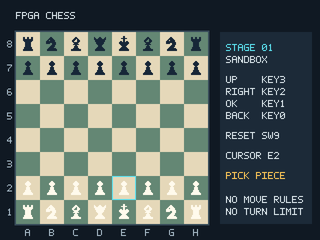

# FPGA_Chessbot

DE1-SoC 上的纯 FPGA 国际象棋项目，使用 Verilog-2001、板载按键和 VGA。

当前实现：**阶段 1——棋盘显示与自由移动交互**。本机仿真和 Quartus 验证结果见
[阶段 1 验证记录](docs/stage1-validation.md)。实际实验室上板尚待验证。



## 操作

| 输入 | 功能 |
| --- | --- |
| KEY[3] | 光标上移，最上行继续按会回到最下行 |
| KEY[2] | 光标右移，最右列继续按会回到最左列 |
| KEY[1] | 选择光标所在棋子；再次确认尝试移到目标格 |
| KEY[0] | 取消选择，保留当前光标位置 |
| SW[9] | 高电平复位；拨回 0 后重新开始 |
| SW[8:0] | 预留，本阶段无功能 |

每次按下/释放均须稳定约 10 ms；长按不会连续移动。光标初始位于 E2。
青色边框是光标，金色边框是已选择的起点，小金色标记表示上一次移动的两格。
选中后确认同一格等同取消。空格不能成为起点，同色棋子不能被覆盖，冲突时显示 BLOCKED。
取消优先于确认，确认优先于移动，同时按上和右时优先上移。

**本阶段不检查棋子走法、路径或轮次**：任何一方的棋子都可以移到任意空格，
也可以替换任意对方棋子；尚不能作为遵循完整规则的国际象棋游戏。

## 工程与工具

- 器件：Cyclone V `5CSEMA5F31C6`；顶层：`DE1_SoC`。
- 打开 `quartus/FPGA_Chessbot.qpf`。
- 已使用 Quartus Prime Lite 18.1.0 Build 625 和 ModelSim Intel FPGA Starter 10.5b 验证。
- 所有自编 RTL/测试平台使用 Verilog-2001。PLL 使用 Intel `altera_pll` 硬件原语；
  仿真链接安装自带的 `altera_lnsim_ver` 库，不需要 CPU、HPS、SDRAM 或下载第三方代码。
- 引脚来自用户提供的 `D:/Quartus/lab1/lab1_part1/DE1_SoC.qsf`；仓库只保留本阶段使用的映射，
  不依赖该外部路径。时序约束由本项目单独提供。

在项目根目录的 PowerShell 中运行：

```powershell
.\scripts\simulate.ps1
.\scripts\build.ps1
```

安装位置不同时可以传入 `-ModelSimBin` 或 `-QuartusBin`。
仿真结果在 `build/sim/`，包括日志、PPM 原始像素帧和 PNG；时序报告在 `build/timing/`。
下载文件在 `quartus/output_files/FPGA_Chessbot.sof`。
构建生成物不提交到 Git；`docs/images/` 中保存少量可审查的仿真截图。

## 实验室使用

1. 给 DE1-SoC 供电，连接 USB-Blaster II 和 VGA 显示器。
2. 用 Quartus Programmer 选择实际连接的 USB-Blaster II，设置 JTAG 模式。
3. 添加 `FPGA_Chessbot.sof`，确认 FPGA 型号匹配，勾选 Program/Configure 并 Start。
4. 将 SW[9] 拨到 1 后拨回 0。显示器应显示 640×480 棋盘；LEDR[9] 表示 PLL 已锁定。
5. 按 KEY[1] 选中 E2，按 KEY[3] 两次到 E4，再按 KEY[1]，应看到棋子移动。
6. 按 [上板检查清单](docs/lab-checklist.md) 记录结果。

`.sof` 是易失性 FPGA 配置，断电后需要重新下载；本阶段没有配置上电自动加载。

## 开发与后续阶段

在本地 `local` 分支开发，先通过仿真、Quartus 编译和时序检查，再合并到 `main` 并推送。
`main` 表示本机验收通过；实验室上板通过是独立记录，不能由仿真代替。

1. 棋盘显示、光标循环、选择/移动/取消、复位。
2. 普通走法、路径阻挡、吃子、兵双步、轮流行棋。
3. 王安全、将军、将死、逼和、王车易位、吃过路兵、四种升变。
4. 完善双人操作、合法目标提示、升变与终局界面。
5. 基础纯 FPGA 机器人和 PVE；先保证合法性及稳定性。
6. 提高棋力、棋钟、悔棋、完整和棋规则，根据时间逐项完成。

详细模块接口和时序设计见 [架构说明](docs/architecture.md)。
