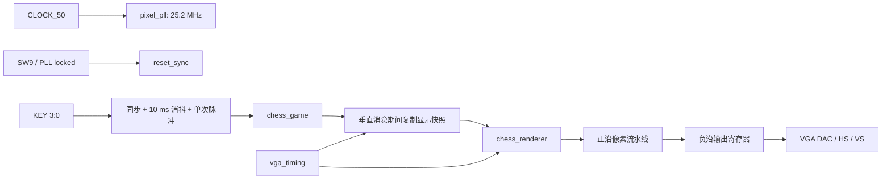

# 阶段 1 架构

## 数据流

PLL 输出为所有功能逻辑提供同一时钟。没有由按键或普通逻辑产生的时钟，也没有 CPU。
复位异步置位、两级同步释放。SW9 同时复位 PLL；即使 PLL 时钟停止，游戏状态也能复位。
PLL 未锁定时保持复位。LEDR[9:0] 依次为 locked、reset、blocked、selected、cursor[5:0]。

## 棋局接口

- `board_state[255:0]`：64 格，每格 4 bit，`board_state[square*4 +: 4]`。
- `square={row[2:0],col[2:0]}`，从屏幕左上 A8=0 到右下 H1=63。
- 低 3 bit：0 空、1 兵、2 马、3 象、4 车、5 后、6 王；最高位 1 为黑方。
- `cursor` 是当前格；`source` 仅在 `selected=1` 时有意义。
- `last_from/last_to/last_valid` 用于最近一次移动标记。
- `blocked` 表示同色目标冲突，在移动光标、取消或下一次确认时清除。

`chess_game` 是唯一修改棋局的模块。当前确认流程直接执行自由移动；阶段 2/3
应在提交更新前接入走法验证，阶段 5 则让机器人提交同样的起点/终点请求。
未来的执行/撤销逻辑应集中处理棋盘与附属状态，避免 UI 或 AI 直接修改棋局。

## VGA

| 项目 | 水平（像素） | 垂直（行） |
| --- | --- | --- |
| 有效显示 | 640 | 480 |
| 前肩 | 16 | 10 |
| 同步脉冲，低有效 | 96 | 2 |
| 后肩 | 48 | 33 |
| 总计 | 800 | 525 |

像素时钟 25.2 MHz，帧率 60 Hz。棋盘左上角 (32,64)，每格 48×48，总计 384×384。
棋子为原创 16×16 单色轮廓，放大两倍；文字为原创 5×7 点阵，放大两倍。
颜色直接按坐标计算，没有帧缓冲或外部内存。

在 `(x,y)=(0,480)` 时原子复制棋盘和 UI 状态；本帧进行的移动到下一帧显示，
正常显示更新延迟小于约 16.7 ms，另加输入消抖时间。游戏状态本身立即更新。

渲染组合逻辑使用一个完整像素周期，在下一个上升沿锁存 RGB 与 HS/VS/BLANK，
再于下降沿送到引脚。所有信号同样延迟一像素，ADV7123 在下一上升沿采样。
消隐期间 RGB 为 0；VGA_SYNC_N 固定为 0，使用独立 HS/VS 同步。

## 时序约束

SDC 定义 50 MHz 输入时钟、派生 PLL 时钟和源自 PLL 实际输出节点的转发 DAC 时钟。
输出 setup/hold 预算为 2.0/2.5 ns，覆盖 ADV7123 3.3 V 数字接口规格并留出板级偏斜余量。
参考：[Analog Devices ADV7123 数据手册 Rev D](https://www.analog.com/media/en/technical-documentation/data-sheets/adv7123.pdf)。
该预算仍需实验室实测确认。

异步 KEY 仅到第一级同步寄存器的路径被排除；同步器两级之间、消抖计数器和游戏逻辑仍受约束。
SW 目前只有异步复位功能，LEDR 为人眼观察输出，因此相应路径是明确的例外。
以后启用其他 SW 时必须增加同步并复核这些例外。

TimeQuest 的 `check_timing` 会提示 5 个输入没有同步输入延迟、11 个输出没有输出延迟，
分别是 KEY[3:0]/SW9 和 LEDR[9:0]/转发 VGA_CLK；本设计不需要虚拟外部时钟。
这些属于明确记录的接口性质，不应通过假造延迟来消除。`report_ucp` 的未约束路径必须为 0。

## 测试

- `tb_button`：抖动、短脉冲、长按、释放抖动、再次按下、复位。
- `tb_game`：独立核对初始 64 格、全部格子上/右循环、选择、取消、移动、吃子、事件优先级和复位。
- `tb_video`：逐像素检查两整帧，共 840000 个周期，包含同步脉冲、前后肩、消隐和帧边界。
- `tb_pll`：Intel 官方 PLL 模型锁定、实际时钟周期、复位同步释放。
- `tb_core`：完整按键到游戏到像素输出链路、帧内状态稳定、流水线对齐，导出三张实际 RGB 帧。
- `tb_top`：未缩短消抖参数的真实顶层、10 ms 阈值、长按不重复、SW9 复位和 PLL 重新锁定。

这些是 RTL 功能仿真及静态时序分析，不是带板级模拟电路的电气仿真，也不是门级时序仿真。
